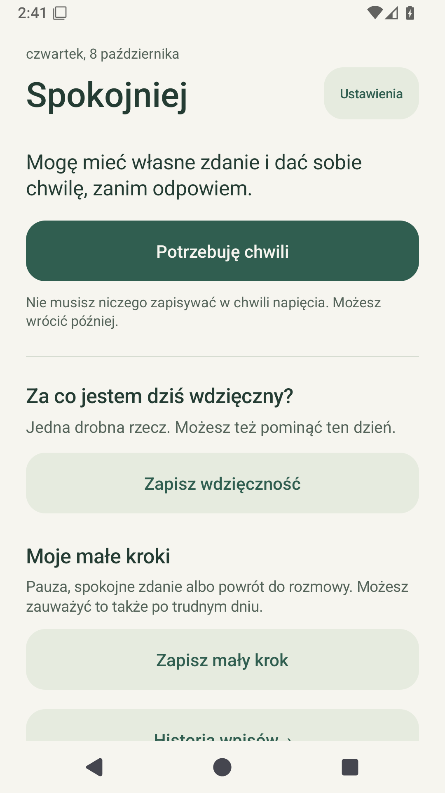
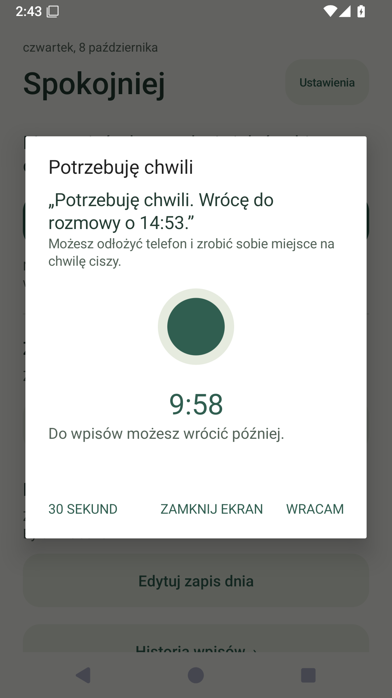
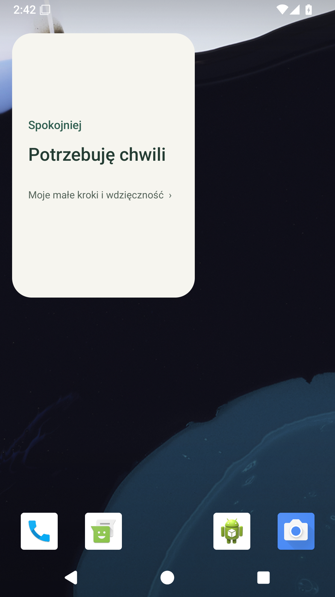

# Spokojniej

**Mała, prywatna aplikacja na Androida: pauza przed odpowiedzią, wdzięczność i małe kroki w stronę spokojniejszych rozmów.**

*A small, private Android app for taking a pause, writing down gratitude and noticing small steps toward calmer conversations.*

Projekt [Po Prostu Koduj](https://poprostukoduj.pl) · Android 8+ · offline · bez konta / no account

**[Pobierz APK / Download APK](https://github.com/paulcrowski/spokojniej/releases/latest)** · [Polski](#polski) · [English](#english)

  
  
  

## Polski

### Co robi aplikacja?

Spokojniej pomaga zauważać dobre momenty i zrobić sobie chwilę przed odpowiedzią. Wszystkie zapisy są dobrowolne. Trudniejszy dzień nie kasuje wdzięczności ani wcześniejszych małych kroków.

- **„Potrzebuję chwili”** — przerwa 10 minut z gotowym zdaniem i godziną powrotu do rozmowy. Można wybrać 30 sekund. Odliczanie trwa także po wyjściu z aplikacji.
- **Widżet** — bezpośrednie otwarcie pauzy jednym dotknięciem na ekranie głównym telefonu; osobny napis otwiera wpisy.
- **Wdzięczność** — jedna dobrowolna notatka na dzień, z możliwością edycji. Można po prostu pominąć dzień.
- **Małe kroki** — „Zrobiłem pauzę”, „Powiedziałem swoje spokojnie”, „Wróciłem do rozmowy spokojniej”. Można także zaznaczyć „Było mi trudno”. Wybory mogą występować razem, również w dniu z kłótnią. Zapis można uzupełnić później.
- **Łagodne przypomnienia** — opcjonalny poranek i chwila przed wieczorem. Domyślne godziny to 08:00 i 18:00; można je zmienić. Przypomnienia są początkowo wyłączone, bez ponagleń i obowiązku podsumowania.
- **Historia i licznik** — zapis spokojnego dnia albo kłótni z datą i godziną, poprawianie i usuwanie wpisów. Licznik pełnych 24 godzin bez kłótni jest niżej na głównym ekranie.
- **Kopia i nowy telefon** — ręczny eksport i import pliku JSON z historią, wdzięcznością, małymi krokami oraz ustawieniami przypomnień.

Aplikacja nie wymaga sięgania po telefon w samym impulsie. Możesz użyć wcześniej uzgodnionego zdania „Potrzebuję chwili. Wrócę o…” bez aplikacji, a zapis dodać później. Samo uruchomienie pauzy nie zapisuje osiągnięcia automatycznie.

### Instalacja APK

1. Pobierz [Spokojniej-1.2.0.apk](https://github.com/paulcrowski/spokojniej/releases/download/v1.2.0/Spokojniej-1.2.0.apk) na telefon z Androidem 8 lub nowszym.
2. Otwórz plik w aplikacji Pliki. Jeśli Android o to poprosi, zezwól tej aplikacji na instalowanie z tego źródła.
3. Zainstaluj i otwórz Spokojniej. Przy aktualizacji **instaluj na obecną aplikację, bez odinstalowywania** — historia zostanie zachowana.
4. W Ustawieniach wybierz przypomnienia i zezwól na powiadomienia, jeśli chcesz ich używać. Widget dodaj przez przytrzymanie ekranu głównego → Widgety → Spokojniej.

Interfejs aplikacji jest obecnie **po polsku**. Dokumentacja i opis wydania są po polsku i angielsku. APK jest udostępniane przez GitHub, poza Google Play.

### Dane, kopia i prywatność

Dane są przechowywane w lokalnej bazie SQLite. Aplikacja działa bez internetu, konta, reklam i analityki. Wymaga tylko uprawnień do powiadomień i uruchomienia przypomnień po restarcie telefonu. Nie nagrywa ani nie analizuje rozmów.

**Przed zmianą telefonu:** Ustawienia → Zapisz kopię → zachowaj plik poza aplikacją. Na nowym telefonie wybierz Wczytaj kopię i potwierdź podgląd. Powiadomienia i widget ustaw osobno w nowym Androidzie.

Import dodaje brakujące wpisy i nie usuwa obecnych. Ponowny import nie mnoży zapisów. Jeśli na daną datę istnieje już wdzięczność, pozostawia tekst zapisany w telefonie. Wersja 1.2 odczytuje także kopie z wersji 1.1. Plik kopii zawiera zwykły tekst wpisów — sam wybierasz miejsce jego przechowywania. Nie ma automatycznej synchronizacji ani systemowej kopii danych. Odinstalowanie lub wyczyszczenie danych aplikacji usuwa lokalną historię.

Android może opóźniać powiadomienia i aktualizację widżetu, zwłaszcza podczas oszczędzania baterii. Licznik mierzy pełne 24 godziny od najnowszej zapisanej kłótni; przed pierwszą kłótnią liczy od pierwszego uruchomienia. Brak wpisu nie potwierdza spokojnego dnia.

Spokojniej jest osobistym narzędziem wspierającym refleksję i komunikację. Nie diagnozuje ani nie leczy ADHD lub lęku.

### Kod i sprawdzenia

Natywna aplikacja Java, bez bibliotek zewnętrznych. SQLite, AlarmManager, powiadomienia, AppWidget i systemowy wybór pliku Androida.

Wersję 1.2.0 sprawdzono w emulatorze Androida 15: **12 sprawdzeń logiki czasu, 22 sprawdzenia migracji poprzednich APK, 57 sprawdzeń Androida oraz 22 sprawdzenia UI i kopii plikowej**. Zainstalowany APK miał tę samą sumę SHA-256 co udostępniany plik. Nie są to testy wszystkich fizycznych telefonów ani ograniczeń baterii producentów.

[Instrukcja budowania](docs/DEVELOPMENT.pl.md) · [Raport PL/EN](docs/VALIDATION.md) · [Dowody testów](docs/validation/v1.2.0)

## English

### What does the app do?

Spokojniej helps you notice good moments and take a short pause before responding. Every entry is optional. A difficult day does not erase gratitude or earlier small wins.

- **“I need a moment”** — a 10-minute break with a ready-to-use phrase and a return time for the conversation. A 30-second option is also available. The countdown continues when you leave the app.
- **Home-screen widget** — open a break directly with one tap; a separate label opens your entries.
- **Gratitude** — one optional, editable note per day. Skipping a day is fine.
- **Small steps** — record taking a pause, expressing your view calmly or returning to a conversation more calmly. You can also record “It was difficult for me.” These choices can coexist, even on a day with an argument, and can be added later.
- **Gentle reminders** — optional morning and pre-evening prompts. Defaults are 08:00 and 18:00; both are editable. Reminders start disabled, without repeated nudges or mandatory daily summaries.
- **History and counter** — record a calm day or an argument with its date and time, then edit or remove entries. The counter of complete argument-free 24-hour periods appears lower on the home screen.
- **Backup and a new phone** — manually export and import a JSON file containing history, gratitude, small steps and reminder settings.

You do not have to reach for your phone during an impulse. You can use an agreed phrase such as “I need a moment. I’ll come back at…” without the app, and add an entry later. Starting a break never records an achievement automatically.

### Install the APK

1. Download [Spokojniej-1.2.0.apk](https://github.com/paulcrowski/spokojniej/releases/download/v1.2.0/Spokojniej-1.2.0.apk) to a phone running Android 8 or later.
2. Open it in your Files app. If Android asks, allow that app to install from this source.
3. Install and open Spokojniej. For updates, **install over the existing app without uninstalling it** to preserve your history.
4. Enable reminders and allow notifications in Settings if you want them. Add the widget by long-pressing your home screen → Widgets → Spokojniej.

The app interface is currently **in Polish**. This documentation and the release notes are bilingual. The APK is distributed on GitHub, outside Google Play.

### Data, backup and privacy

Entries are stored in a local SQLite database. The app works without internet access, accounts, ads or analytics. Its only permissions are for notifications and rescheduling reminders after a reboot. It does not record or analyze conversations.

**Before changing phones:** Settings → save a backup → keep the file outside the app. On the new phone, import the file and confirm the preview. Notification permission and the widget must be configured separately on the new Android device.

Import adds missing entries without deleting existing ones. Importing the same file again does not multiply entries. If gratitude already exists for a date, the phone’s current text is preserved. Version 1.2 also reads backups from version 1.1. Backup files contain plain-text entries; you choose where to store them. There is no automatic sync or Android system backup. Uninstalling the app or clearing its data removes the local history.

Android may delay notifications and widget updates, especially under battery-saving restrictions. The counter measures complete 24-hour periods since the most recently recorded argument, or since first launch when no argument has been recorded. Missing entries do not confirm a calm day.

Spokojniej is a personal tool for reflection and communication. It does not diagnose or treat ADHD or anxiety.

### Source and verification

Native Java with no third-party libraries: SQLite, AlarmManager, notifications, AppWidget and Android’s system document picker.

Version 1.2.0 was checked on an Android 15 emulator: **12 time-logic checks, 22 previous-APK migration checks, 57 Android checks and 22 UI/file-backup checks**. The installed APK matched the published file’s SHA-256 hash. These checks do not cover every physical phone or manufacturer’s battery restrictions.

[Build instructions](docs/DEVELOPMENT.en.md) · [PL/EN validation report](docs/VALIDATION.md) · [Test evidence](docs/validation/v1.2.0)

## Project

Created for [Po Prostu Koduj](https://poprostukoduj.pl). Source code lives in `app/`, build scripts in `scripts/`, and checks in `tests/`. Installable APKs are published in [GitHub Releases](https://github.com/paulcrowski/spokojniej/releases).
